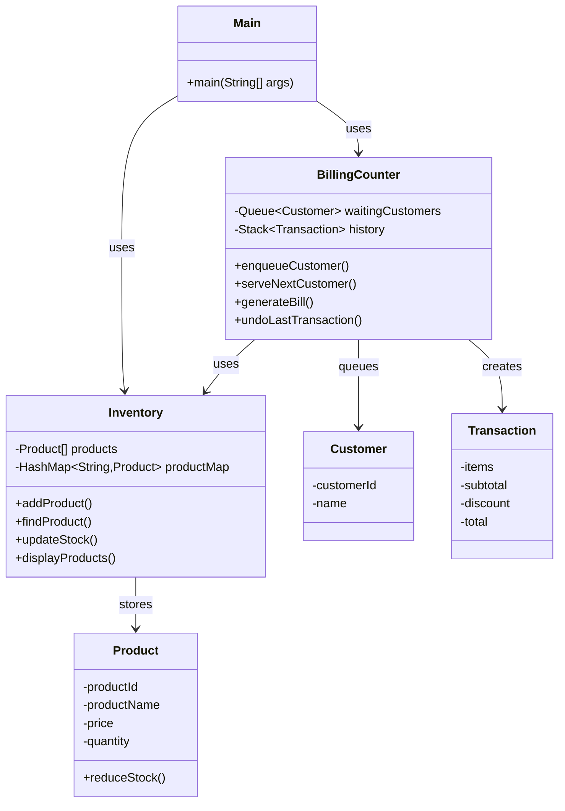

# 🛒 Supermarket Billing System

A menu-driven **Java console application** that manages products, maintains inventory and generates customer bills. Built as a **Data Structures and Algorithms (DSA)** project to demonstrate four core data structures: **Array, HashMap, Queue and Stack**.

> This is an academic console-based demonstration, not a complete commercial point-of-sale platform.


---

## 📌 Table of Contents

- [Features](#-features)
- [Data Structures Used](#-data-structures-used)
- [Project Structure](#-project-structure)
- [Class Diagram](#-class-diagram)
- [Getting Started](#-getting-started)
- [Usage](#-usage)
- [Billing Calculation](#-billing-calculation)
- [Sample Output](#-sample-output)
- [Complexity Analysis](#-complexity-analysis)
- [Validation and Error Handling](#-validation-and-error-handling)
- [Scope](#-scope)
- [Future Scope](#-future-scope)
- [Author](#-author)

---

## ✨ Features

- View all products and search a product by ID
- Add customers to a waiting queue and serve them in arrival order
- Generate a bill with line amounts, subtotal, discount and final payable amount
- Automatic stock update after a confirmed sale
- View the most recent transaction
- Undo the latest transaction (stock is restored)
- Input validation and error handling that never crashes the menu

## 🧠 Data Structures Used

| Data Structure | Java Class | Purpose | Time |
|---|---|---|---|
| **Array** | `Product[]` | Stores product records (ID, name, price, quantity) | Access `O(1)`, display `O(N)` |
| **HashMap** | `HashMap<String, Product>` | Finds a product by its unique ID | `O(1)` average |
| **Queue (FIFO)** | `Queue<Customer>` via `LinkedList` | Serves customers in arrival order (`offer()` / `poll()`) | `O(1)` |
| **Stack (LIFO)** | `Stack<Transaction>` | Keeps recent bills, latest on top, used for undo | `O(1)` |

## 📁 Project Structure

```
SupermarketBilling/
├── Main.java           # Menu-driven console interface
├── Inventory.java      # Array storage + HashMap index
├── BillingCounter.java # Customer Queue, transaction Stack, billing
├── Product.java        # Product record with stock handling
├── Customer.java       # Customer waiting in the queue
├── Transaction.java    # Bill items, totals and receipt
└── README.md
```

## 🧩 Class Diagram



## 🚀 Getting Started

### Prerequisites

- **JDK 8 or above**
- Any editor (VS Code, IntelliJ IDEA, Eclipse) or just a terminal
- Windows or Linux
- Minimum 4 GB RAM recommended

### Clone and run

```bash
git clone https://github.com/<your-username>/supermarket-billing-system.git
cd supermarket-billing-system

javac *.java
java Main
```

> Replace `<your-username>` with your GitHub username.

## 🖥️ Usage

```
========== SUPERMARKET BILLING SYSTEM ==========
1. Display Products
2. Search Product by ID
3. Add Customer to Queue
4. Serve Next Customer
5. Generate Customer Bill
6. View Recent Transaction
7. Undo Latest Eligible Transaction
8. Exit
Enter your choice:
```

**Typical flow:** `3` add customer → `4` serve next customer → `5` generate bill (enter product ID and quantity, type `DONE` to finish, confirm with `Y`) → `6` view the transaction.

**Sample products loaded at start**

| ID | Name | Price | Stock |
|---|---|---|---|
| P101 | Rice 5kg | 320 | 20 |
| P102 | Cooking Oil 1L | 145 | 30 |
| P103 | Sugar 1kg | 48 | 25 |
| P104 | Tea 250g | 110 | 15 |

## 🧮 Billing Calculation

```
Line Amount  = Unit Price × Quantity
Subtotal     = Sum of all line amounts
Discount     = Subtotal × Discount Rate      (default 5%)
Final Amount = Subtotal − Discount
```

The discount rate is the `DISCOUNT_RATE` constant in `BillingCounter.java`.

## 🧾 Sample Output

Billing P101 × 1 and P103 × 2 with a 5% discount:

```
=============== RECEIPT ===============
Customer : C1 - Asha
---------------------------------------
ID     Item              Qty     Amount
P101   Rice 5kg            1     320.00
P103   Sugar 1kg           2      96.00
---------------------------------------
Subtotal                         416.00
Discount (5%)                    -20.80
FINAL AMOUNT (Rs)                395.20
=======================================
Confirm sale? (Y/N): Y
Sale completed. Stock updated.
```

Requesting more than the available stock (for example 100 units of P104 when stock is 15):

```
Insufficient stock; item not added.
```

## ⏱️ Complexity Analysis

| Operation | Structure | Time |
|---|---|---|
| Access by index | Array | `O(1)` |
| Display products | Array | `O(N)` |
| Find product by ID | HashMap | `O(1)` average |
| Add customer | Queue | `O(1)` |
| Serve customer | Queue | `O(1)` |
| Push / pop history | Stack | `O(1)` |
| Calculate bill (K items) | Billing | `O(K)` |

**Space:** `O(N)` for products (array + HashMap), `O(C)` for waiting customers, `O(T)` for stored transactions and `O(K)` for a bill with K line items.

## 🛡️ Validation and Error Handling

- Blank product IDs and customer names are rejected
- Only positive whole-number quantities are accepted
- Product existence is checked before billing
- Requested quantity cannot exceed available stock
- Empty customer queue and empty transaction stack are handled
- Invalid menu options are rejected without crashing

## 📐 Scope

**Included:** product listing and lookup, customer queue management, bill generation, stock updates, transaction history and undo, console interface.

**Not included:** database, barcode scanner, online payment gateway, GST-compliant invoicing, multi-branch synchronisation, authentication and graphical interface.

## 🔮 Future Scope

- Database integration (MySQL) for products, customers and transactions
- Graphical user interface using Swing or JavaFX
- Barcode scanning
- GST invoicing with configurable tax
- Payment integration (cash, card, UPI)
- User authentication with administrator and cashier roles
- Sales reports (daily, weekly, monthly)
- Low stock alerts
- `ArrayList` for a flexible product catalogue
- Persistent transaction history saved across restarts

## 👤 Author

**Anshu Patel**
ERP ID: RU-25-10243
B.Tech in Computer Science & Engineering with Full Stack
School of Computer Science and Engineering, Rungta International Skills University, Bhilai, Chhattisgarh

**Guide:** Mr. Abhijeet Dutta, SME
**Course:** Data Structures and Algorithms (DSA), Session 2026-27

---

⭐ If you find this project useful, consider giving it a star.
